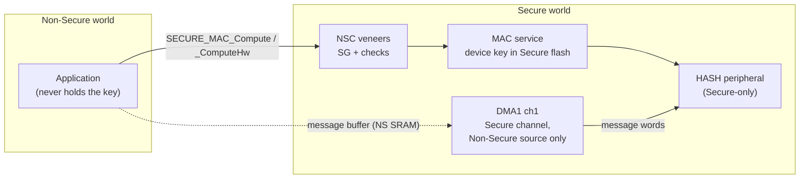

# What Does Hardware Isolation Cost on a Real-Time Microcontroller?

**A measurement study of TrustZone-M on the Cortex-M33**

Eugene Olowofela, P.Eng · October 2026 · Code and data: <https://github.com/eugeneade/trustzone-m-secure-edge>

## Abstract

I built a small message-authentication service on an STM32L552 (Arm Cortex-M33, 110 MHz) in
which the device key lives only in the TrustZone Secure world. I then measured, cycle by
cycle, what that isolation costs. The hardware world switch is cheap: 38 cycles for an empty
round trip, most of which is compiler-inserted register scrubbing. The cost of a real Secure
service is dominated by software around the gate. In the first version, 62% of the overhead
was erasing one 32-byte tag with a byte-wise `memset`. Fixing it cut the overhead by 44%.
The remaining variation between builds comes from instruction-cache conflicts between the
two worlds, confirmed with the cache's miss counter. Secure code adds a bounded 9 cycles to
Non-Secure interrupt latency. Moving the MAC to the on-chip HASH accelerator makes it 28–29×
faster, but turns the fixed boundary cost from under 1% into 22% of a short MAC. It also
exposed a worst-case latency hazard: CPU writes to the accelerator stalled interrupts for up
to 52 extra cycles. I traced the hazard to a single driver phase and removed it by feeding
the accelerator with a Secure DMA channel restricted to Non-Secure memory.

## 1. Question

Autonomous edge systems need authenticated communication under real-time constraints.
Hardware isolation such as TrustZone-M promises to keep keys away from compromised
application code. My question: **which security responsibilities should sit behind the
hardware boundary, which in hardware accelerators, and what does each choice cost in latency
and determinism?** This report answers the cost part for one concrete service, HMAC-SHA256
with an isolated device key, on one widely deployed microcontroller.

## 2. Platform and threat model

**Platform.**
- **Board and clock:** NUCLEO-L552ZE-Q (STM32L552ZE, Cortex-M33 with TrustZone-M and FPU),
  110 MHz.
- **Memory system:** flash at 5 wait states, 8 KB two-way instruction cache.
- **Toolchain:** GCC 14.3 at `-O2`, mbedTLS 3.6.7 (SHA-256 only).
- **TrustZone partition:**
  - flash bank 1 is Secure, with an 8 KB Non-Secure-Callable (NSC) veneer region;
  - flash bank 2 is Non-Secure;
  - SRAM is split by the GTZC block-based protection;
  - the HASH peripheral is made Secure-only.

**Threat model.** The attacker controls all Non-Secure code and wants the device key or a MAC
it shouldn't be able to produce. In scope:
- direct reads of Secure memory;
- passing crafted pointers to the Secure service (a "confused deputy" attack);
- re-entering the service from an interrupt handler;
- reading Secure register contents after a world switch.

Out of scope: physical attacks, fault injection, power and timing side channels beyond a
constant-time MAC comparison, and debug access. The board runs at read-protection level 0
with debug enabled; Section 6 covers what that means.

## 3. Design

The Non-Secure application reaches the Secure world only through NSC entry points: compute
MAC (software or hardware), verify MAC in constant time, and run the RFC 4231 self-test.
Every buffer the application passes in is checked with `cmse_check_address_range` before
use, so the service can't be tricked into reading or writing Secure memory on the caller's
behalf. Verified on the board:
- the checks refuse pointers into Secure flash and Secure SRAM;
- a direct Non-Secure read of Secure flash raises a SecureFault (attribution unit
  violation);
- the hardware and software MACs match each other at 14 boundary lengths, and the RFC 4231
  vectors;
- the device MAC matches an independent host implementation (.NET `HMACSHA256`).

## 4. Method

**Timing.** All timings use the DWT cycle counter with interrupts masked:
- 1000 timed runs after 10 warm-up runs per row, reporting medians;
- every operation goes through the same function-pointer harness, so both sides of each
  difference have the same call depth;
- every reported configuration was run twice, and both runs gave identical minimum, median
  and maximum values.

**Three further instruments.**
1. **In-world timing.** Probe entry points time each step of the Secure service from inside
   the Secure world, so the steps add up without cross-world noise.
2. **Cache misses.** The instruction cache's hardware miss counter is read around single
   calls.
3. **Interrupt latency.** A Non-Secure timer interrupts every 7,919 cycles. The period is
   prime, so interrupts land at many points of the running code. The handler's first action
   reads the timer, giving the cycles from the timer event to the handler. A phase marker,
   written by the Secure driver into a Non-Secure word, records where each interrupt landed.

The cycle counter counts in Secure state only while Secure debug is allowed (true at RDP
level 0). The in-Secure HMAC timings confirm that it counted there.

## 5. Results

### 5.1 The hardware gate is cheap; the ABI around it is not free

An empty Non-Secure call takes 7 cycles; an empty call into the Secure world and back takes
45. So the round trip costs **38 cycles (0.35 µs)**. The veneer is one `SG` instruction and a
branch. The return path the compiler generates for a Secure entry function is 30
instructions. Twenty of them clear registers that could leak Secure values: 4 core registers
and 16 floating-point registers, because the build uses the hard-float ABI. The FPSCR and
flags are cleaned too, before `BXNS`. Most of the boundary cost is this mandatory scrubbing,
not the hardware gate itself.

### 5.2 A real service's overhead is mostly software hygiene

HMAC in the Secure service cost a fixed 404 cycles more than the same code in the
Non-Secure world, at every message size. Timing each step inside the Secure world
(64-byte message, cycles):

| Step | Before fix | After fix |
|------|-----------:|----------:|
| World switch | 38 | 38 |
| Passing three arguments | 4 | 4 |
| Pointer checks (`cmse_check_address_range` ×2) | 93 | 96 |
| Copying the 32-byte tag out | 16 | 19 |
| **Zeroizing the 32-byte tag** | **250** | **35** |
| HMAC core, Secure minus Non-Secure | ≈1 | 8 |
| **Measured total** | **404** | **226** |

The largest cost was erasing secrets. `mbedtls_platform_zeroize` calls newlib-nano's
size-optimized `memset`, which clears one byte per loop iteration. A word-wise volatile
erase cut that step from 249 to 35 cycles, measured in the same build, and the end-to-end
overhead fell by 44%. The isolation hardware itself (switch plus arguments, 42 cycles)
accounts for under a fifth of the remaining cost.

### 5.3 Code placement and the instruction cache

With no change to the service's source, its overhead moved between 226 and 639 cycles
across builds. The cache's miss counter explains why:

| Path (per call) | Instruction-cache misses |
|-----------------|-------------------------:|
| HMAC in Non-Secure | 15 |
| Secure software MAC service | 40 |
| Same steps from different addresses (step probe) | 0 |
| Hardware MAC service | 0 |

The residual tracked the service's extra misses at about 8–10 cycles per miss in all three
builds examined. Without misses, the HMAC core takes the same 32,130 cycles in either world.
Hot Secure and Non-Secure code land in the same cache sets and evict each other, so the
cost of isolation depends on the linker's placement as much as on the architecture.

### 5.4 Secure code adds a small, bounded interrupt latency

| CPU was running | Median | Max |
|-----------------|-------:|----:|
| Idle Non-Secure loop | 21 | 21 |
| 1 KB HMAC in Non-Secure | 21 | 21 |
| 1 KB HMAC inside the Secure service (~1 ms) | 30 | 32 |

Cycles from the timer event to the Non-Secure handler. An interrupt that arrives during Secure
code waits 9–11 cycles longer, while the core saves additional Secure state and clears
registers. The delay doesn't grow with the length of the Secure operation, but only because
the service never masks interrupts. A Secure critical section would add its full length to
Non-Secure latency.

### 5.5 Hardware acceleration moves the bottleneck to the boundary

| Bytes | Software, Secure service | Hardware, Secure service | Hardware alone | Speedup | Boundary share |
|------:|-------------------------:|-------------------------:|---------------:|--------:|---------------:|
| 16 | 27,150 | 943 | 738 | 28.8× | 22% |
| 1024 | 109,971 | 3,991 | 3,786 | 27.6× | 5% |

Median cycles. The fixed service overhead around the accelerator is 205 cycles: 22% of a
16-byte MAC, against under 1% with software crypto. **Once the crypto is in hardware, the
cost of crossing into the Secure world becomes a first-order design concern for short
messages.**

Sharing the accelerator needs arbitration. A Non-Secure interrupt handler can call the
service while an earlier call is suspended mid-computation. A busy flag refuses such
nested calls. Under load, 848 of 1,000 interrupt-time requests were refused and 152
completed. All of those 152, and all 1,750 main-loop MACs, were correct. An interrupt
handler therefore needs a fallback policy, such as software or a later retry.

### 5.6 A worst-case latency hazard in the accelerator path, and its fix

With the message fed to the accelerator by CPU writes, Non-Secure interrupt latency during a
hardware MAC had a median of 35 cycles but a **maximum of 64–76**.

1. **Ruled out FIFO-full stalls.** Waiting in an interruptible loop for the core to go idle
   before each block did not lower the maximum.
2. **Located the stall.** With the phase marker, every elevated sample fell while the CPU was
   writing message words to the data register (702 samples, max 76). The waits, the key
   phases and the digest read stayed at 33–35. A data-register write that hands a full block
   to the hash core stalls the CPU on the bus during the hand-over, and the core can't take
   an interrupt until that write completes.
3. **Fixed with DMA.** A DMA channel now feeds the message, and the CPU waits by polling the
   DMA status, never the accelerator.

| Interrupt latency during 1 KB hardware MAC | Median | Max |
|--------------------------------------------|-------:|----:|
| CPU feeds the message | 34–35 | 64–76 |
| **DMA feeds the message** | **37** | **38** |

The DMA channel is Secure, but its source is marked Non-Secure, so the DMA hardware itself
can't read Secure memory even if a bad pointer got past the software checks. The worst case
is now one cycle above the median, at no throughput cost for 1 KB messages. One
board-specific detail: the DMAMUX request routing is silently ignored unless it is written
after the DMA channel is made Secure.

## 6. Limitations

- **Platform scope.** One chip, one compiler (GCC 14.3, `-O2`, hard-float ABI) and one cache
  configuration. Cycle counts will differ elsewhere; the mechanisms should not.
- **Steady-state measurements.** All numbers are warm-cache, steady-state values.
  Cold-start and first-call latency are not measured.
- **Debug-dependent timing.** The board runs at RDP level 0 with debug enabled, which the
  cycle-counter method requires. A deployed device would raise RDP, and its timing would
  need a hardware timer instead.
- **Partial interrupt-latency coverage.** Only interrupt entry latency is measured: not the
  return to interrupted Secure code, and not the case of Secure code with live
  floating-point state.
- **Demo key.** The device key is compiled into Secure flash. A production device would
  provision a separate key into each unit.
- **No framework comparison.** I did not measure a full framework such as Trusted
  Firmware-M. A TF-M forum presentation on v1.5.0 reported about 20,000 cycles of PSA API
  overhead per `psa_call`, as quoted on the TF-M mailing list. My bare NSC service overhead (205–450
  cycles) is roughly 45–100× lower, so the framework, not the hardware, would dominate such
  a design. That comparison is not mine to claim without measuring it on this board.

## 7. Open questions

1. **Placement as a security-performance knob.** Can linker placement or cache partitioning
   make isolation cost predictable across builds? Would that allow worst-case latency
   guarantees for Secure services?
2. **Boundary cost vs acceleration.** As accelerators shrink the crypto cost, what is the
   right granularity for Secure calls: batching several messages per call, or moving the
   protocol logic itself behind the boundary?
3. **Interrupt-safe shared accelerators.** What arbitration policy (refuse, queue,
   preempt-and-restore context, software fallback) gives the best worst-case latency for
   mixed-criticality callers?
4. **ABI choices.** How much of the 38-cycle gate is floating-point register scrubbing that a
   soft-float Secure image, or Armv8.1-M's `VSCCLRM`, would remove? What does that trade
   against floating-point performance in Secure code?

## References

- Arm, *Armv8-M Architecture Reference Manual* (DDI 0553): Security Extension, exception
  entry with additional state context, SG/BXNS.
- STMicroelectronics, *RM0438 Reference Manual: STM32L552xx and STM32L562xx*: GTZC, HASH,
  DMA/DMAMUX, ICACHE.
- H. Krawczyk, M. Bellare, R. Canetti, *HMAC: Keyed-Hashing for Message Authentication*,
  RFC 2104, 1997.
- M. Nystrom, *Identifiers and Test Vectors for HMAC-SHA-224, -256, -384, and -512*, RFC
  4231, 2005.
- Mbed TLS 3.6 LTS, <https://github.com/Mbed-TLS/mbedtls>.
- Trusted Firmware-M, <https://www.trustedfirmware.org/projects/tf-m/>. PSA API overhead
  figure: TF-M Forum, "TF-M Performance Improvement in v1.5.0", 9 Dec 2021, as quoted on the
  tf-m mailing list, 18 Feb 2022.
- D. Oliveira, T. Gomes, S. Pinto, *uTango: an open-source TEE for IoT devices*,
  arXiv:2102.03625, 2021. An open-source TEE design for Armv8-M.
